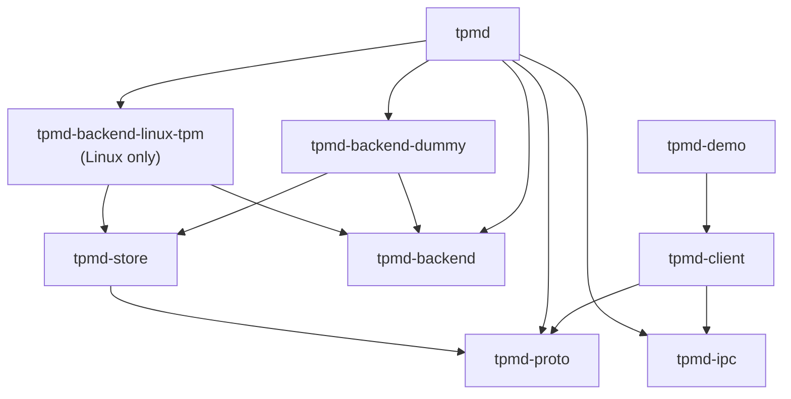
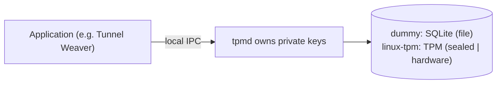

# tpmd — architecture and custody notes

> Companion to [`protocol.md`](protocol.md). WVR-140 built the first backend
> (dummy) and the whole consumer contract; WVR-141 added the Linux TPM backend
> (`sealed` and `hardware`). Later tickets add the OS-keyring and the
> Windows/macOS hardware backends behind the same interfaces.

## Workspace

`tpmd` is an independent Rust workspace. Tunnel Weaver is the first *consumer*,
not a dependency: nothing here links against Tunnel Weaver, and the toy proves
the life-cycle with a simulated relay.

| Crate | Responsibility | Notable dependencies |
| --- | --- | --- |
| `tpmd-proto` | Serializable messages, Postcard frame codec, limits, version negotiation | `serde`, `postcard` — no OS or storage deps |
| `tpmd-backend` | The `Backend` trait (async, object-safe), `SecurityLevel`, `Principal`, `Owner`, error taxonomy, `select_level` | `tpmd-proto`, `async-trait` |
| `tpmd-store` | SeaORM entities + migrations for the **one shared SQLite file** | `sea-orm`, `sea-orm-migration` |
| `tpmd-backend-dummy` | SQLite software P-256 store (level `file`) | `tpmd-store`, `p256` |
| `tpmd-backend-linux-tpm` | Linux TPM 2.0 store (levels `sealed`, `hardware`) | hand-rolled TPM2 over `/dev/tpmrm*`, `tpmd-store`, `p256`, `zeroize` |
| `tpmd-ipc` | Local endpoints, native caller authentication, secure filesystem, framed I/O | `tokio`, `libc` / `windows-sys` |
| `tpmd` | Daemon: serve loop, caller auth, namespace + floor enforcement, backend registry and selection, CLI | the above |
| `tpmd-client` | Consumer API hiding the transport | `tpmd-proto`, `tpmd-ipc` |
| `tpmd-demo` | Toy consumer that walks the Tunnel Weaver life-cycle | `tpmd-client`, `p256` |

Three crates are not in the ticket's original list but are structurally required:

* **`tpmd-backend`** holds the trait both the daemon and every backend depend
  on. A backend cannot depend on the daemon (that would be a dependency
  cycle), so the shared interface lives in its own crate — exactly the
  "internal non-backend crate" the architecture document anticipates.
* **`tpmd-ipc`** holds the platform layer (endpoints, caller credentials,
  secure files) that both the daemon and the client need, plus the safe
  filesystem helpers every backend uses.
* **`tpmd-store`** owns the single SQLite file the backends share. It is a
  crate rather than a module because two independent backend crates need the
  same schema, and because keeping the ORM out of `tpmd-backend` leaves the
  trait crate a pure interface.

### One crate per backend mechanism, selected at runtime

Backends are one crate each, so a Windows or macOS build never compiles the
Linux TPM code (it is `#![cfg(target_os = "linux")]` and is only pulled in by a
target-gated dependency). **What is built** is a compile-time property; **what
is used** is decided at run time:

* the daemon registers every backend built for this OS;
* each backend answers `can_be_used()` — can it actually work *here*? (the TPM
  backend opens the device; the dummy always says yes);
* selection keeps the usable ones and picks the strongest `default_level()`,
  with the dummy as the guaranteed floor of the ladder;
* `--backend <NAME>` forces one and is refused with a clear error when it is
  not built for this platform or not usable on this host.

The daemon drives whichever won through one `Arc<dyn Backend>`, so adding a
backend is a new crate plus a registry entry, not a rewrite.



## Trust model



* The daemon is the **only** holder of private material and exposes operations,
  never key export. There is no export operation anywhere in the protocol.
* A process running as the **same OS user** is inside that user's trust
  boundary. The daemon's guarantee is *cross-principal* and *cross-namespace*
  isolation, not defence against the user's own malware.
* **Caller identity is not client-supplied.** It is derived from kernel peer
  credentials (`SO_PEERCRED`/`LOCAL_PEERCRED` on Unix, the named-pipe client's
  token SID on Windows). A UID or SID in a request payload is never trusted.
* Keys are addressed by `(principal, namespace, key_id)`. A lookup under the
  wrong principal or namespace returns `unknown_key` — "not yours" and "does
  not exist" are indistinguishable, so key existence never leaks.
* There is **no enumeration**: a caller can only address a key it already
  knows the fingerprint of.

## Security levels and the floor

```
hardware > sealed > keyring > file
```

* `--min-key-security` defaults to `sealed`.
* The dummy backend achieves only **`file`**: software keys in a
  permission-protected file, neither encrypted nor hardware-backed. It reports
  `file` truthfully in `WELCOME`, `status` and every `KeyInfo` — never
  `keyring`, `sealed` or `hardware`.
* The Linux TPM backend achieves **`sealed`** (a software scalar hardware-wrapped
  at rest; the plaintext exists only while signing) and **`hardware`** (a
  non-exportable, non-duplicable key whose signing happens inside the TPM). It
  advertises both, and reports the level a key was actually created at — never
  inferred from the backend's name.
* `select_level` (in `tpmd-backend`) is the one place the "never silently
  weaken policy" rule lives: it returns the strongest available level at or
  above the requested floor, or refuses with `incompatible_policy` naming the
  required and available levels unless the caller passed `allow_below_floor`.
* Restarting or reconnecting never rewrites a key's level, and a lost key is
  never replaced by a weaker one behind the caller's back.

## Platform details

| Concern | Linux | macOS | Windows |
| --- | --- | --- | --- |
| Per-user endpoint | `$XDG_RUNTIME_DIR/tpmd/tpmd.sock` | `$TMPDIR/tpmd/tpmd.sock` | `\\.\pipe\tpmd-<fnv1a-of-SID>` |
| System endpoint | `/run/tpmd.sock`, mode `0666` | — | — |
| Caller identity | `SO_PEERCRED` uid | `LOCAL_PEERCRED` uid | client token SID |
| Store directory | `$XDG_DATA_HOME/tpmd` (or `~/.local/share/tpmd`); system mode `/var/lib/tpmd` | `~/Library/Application Support/tpmd` | `%LOCALAPPDATA%\tpmd` |
| Store protection | dir `0700`, DB `0600`; the WAL `-wal`/`-shm` sidecars live in that directory | same | protected owner-only DACL on dir and file |
| Pipe protection | — | — | protected owner-only DACL on the pipe |
| TPM device | `/dev/tpmrm0`…`tpmrm15`, then `/dev/tpm0` (override `TPMD_TPM_DEVICE`); normally `tss:tss 0660` | — | — |

The `tpmd-client` looks for the user-scoped endpoint first, then the system
endpoint, so an application does not care whether the daemon runs per-user or
as a shared service.

### Per-user vs shared daemon

On **Windows and macOS the daemon runs as the non-root user**, so the OS scopes
the store to that user. On **Linux** it may run per-user or as a shared system
service; in the shared case, rows carry the authenticated `principal` so one
store serves many users safely. Both modes use the same code — in per-user mode
the principal is simply constant.

Mode is chosen with `--user` or `--system`, and defaults to `--system` when the
effective uid is 0. System mode binds `/run/tpmd.sock` with mode `0666` and
uses `/var/lib/tpmd`. **Reachability is not authorization**: the socket being
world-connectable only means a foreign user can connect and be told
`unknown_key`; every operation is still scoped to the caller's kernel-derived
principal.

`/run` is `root:root 0755`, so the `tss` daemon cannot create the socket's
directory itself. The deployment owns that (a systemd `RuntimeDirectory=`, a
`tmpfiles.d` entry, or the later installer); the daemon only binds the
configured path and applies the mode, and fails loudly if the directory is
missing. Tests use `--socket` in a temporary directory.

## Linux TPM custody (WVR-141)

The TPM layer is driven by a **hand-rolled TPM 2.0 transport** (a TCTI over the
kernel resource-manager device, plus the handful of Part 2 structures the
backend needs) rather than libtss2, so `cargo build` needs no C toolchain and
the crate cross-compiles and unit-tests anywhere. Only the wrapped blobs are
persisted; the storage parent is recreated deterministically on each run.

| Aspect | Behaviour |
| --- | --- |
| Parent | ECC P-256 storage primary under the owner hierarchy, `restricted \| decrypt`, AES-128-CFB wrapping; a signing key **cannot** be a primary on this firmware (`TPM_RC_ATTRIBUTES`) |
| `hardware` child | `fixedTPM \| fixedParent \| sensitiveDataOrigin \| userWithAuth \| sign \| noDA` — non-exportable, non-duplicable; signing inside the TPM |
| `sealed` object | a `KEYEDHASH` object holding the software scalar; unsealed only to sign, then `zeroize`d |
| Signature | `TPMT_SIGNATURE` (`sigAlg \| hash \| TPM2B r \| TPM2B s`) → 64-byte `r ‖ s`, each half left-padded to 32 bytes |
| Persistence | `private_blob` (TPM-wrapped) + `public_blob` in `tpm_keys`; the sibling of `keys` in the same SQLite file |
| Device permissions | `/dev/tpmrm*` is `tss:tss 0660`; the system daemon runs as `tss` and clients never open the device |
| Key loss | a firmware reset or `TPM2_Clear` invalidates the parent → reload fails with `TPM_RC_INTEGRITY`, surfaced as `key_loss` (re-pair), never a silent re-mint |
| Transient access failure | an unopenable device is `backend_unavailable`, distinct from a policy mismatch |

## Signing contract

ECDSA P-256 / SHA-256, matching `weaver_mux::auth`. Public key = 33-byte SEC1
compressed (also the fingerprint); signature = 64-byte raw `r ‖ s`. The daemon
hashes the message with SHA-256 exactly once and signs the digest; signing is
deterministic per RFC 6979. See [`protocol.md` §10](protocol.md#10-signing-contract-the-part-that-must-be-exact).

## Evidence

### WVR-140 (dummy backend, consumer contract)

Proven on this Linux machine and asserted in the test suite:

* The documented happy path runs end to end (`tpmd-demo run`): it starts the
  real agent, is refused at the `sealed` floor, provisions at `file` with
  consent, enrols the public key, signs a Tunnel Weaver-style transcript,
  verifies it independently, restarts the agent and resumes the same identity,
  destroys and re-creates, and shows an unreachable agent.
* A signature produced by tpmd was verified with **Tunnel Weaver's own**
  `weaver_mux::auth::verify` (a throwaway interop test, since tpmd must not
  depend on Tunnel Weaver).
* Frame bounds, malformed/zero-length frames, version and handshake mismatches,
  namespace limits, disconnects, concurrency, restart persistence, namespace
  isolation and floor refusal each have tests.
* Cross-user isolation is exercised with a real second OS account
  (`tpmdtest`): the second user cannot reach the socket, and when the socket is
  reachable it still gets `unknown_key`.
* The dummy engine builds on all three target OSes; the Windows transport code
  is compiled for `x86_64-pc-windows-msvc` and the full suite runs on the
  Windows VM and the M1 Mac used to prove the platform backends.

### WVR-141 (Linux TPM backend)

Proven on this machine's AMD firmware TPM and asserted by device-gated tests
(`crates/tpmd-backend-linux-tpm/tests/device.rs`, which self-skip where no TPM
is reachable):

* A `hardware` key provisioned, signed the documented Tunnel Weaver transcript,
  and the signature verified independently with the `p256` crate; a mutated
  transcript and a mutated signature were both rejected.
* A `sealed` key provisioned, signed, and verified the same way.
* Both survive a process restart: a fresh backend reopened the store, resumed
  the same fingerprint, and signed again — only the wrapped blob is persisted,
  and the storage parent is recreated deterministically.
* Keys are scoped to the authenticated principal: another principal addressing
  a known fingerprint gets `unknown_key` on both `describe` and `sign`.
* The command bytes are unit-tested against the wire format (an empty
  `TPM2B_SENSITIVE_CREATE` is 4 bytes, `inPublic` is a length-prefixed
  `TPM2B_PUBLIC`, an ECC `unique` is two `TPM2B`s), and the documented
  transcript hashes to the same digest the macOS and Windows runs produced.

## Out of scope

Keyring, Windows CNG and macOS Secure Enclave backends, and the Linux/user mode
of the TPM crate (WVR-142/143/144/151); packaging and installers
(WVR-145…150); any real relay (the demo's relay is simulated); `sign_prehash`;
additional algorithms.
