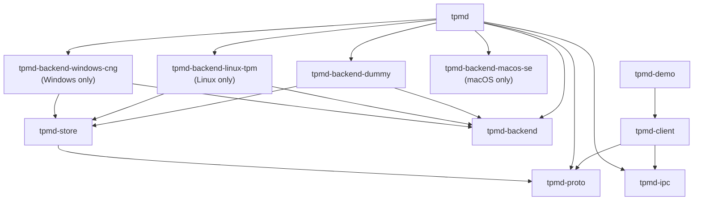
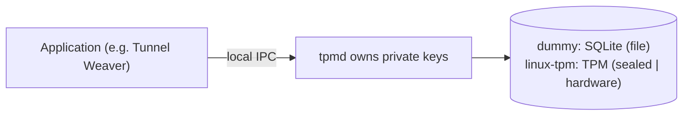

# tpmd — architecture and custody notes

> Companion to [`protocol.md`](protocol.md). WVR-140 built the first backend
> (dummy) and the whole consumer contract; WVR-141 added the Linux TPM backend
> (`sealed` and `hardware`). Later tickets add the OS-keyring and the
> Windows/macOS hardware backends behind the same interfaces.

## Workspace

`tpmd` is an independent Rust workspace. Tunnel Weaver is the first *consumer*,
not a dependency: nothing here links against Tunnel Weaver, and the toy proves
the life-cycle with a simulated relay.

| Crate | Responsibility | Notable dependencies |
| --- | --- | --- |
| `tpmd-proto` | Serializable messages, Postcard frame codec, limits, version negotiation | `serde`, `postcard` — no OS or storage deps |
| `tpmd-backend` | The `Backend` trait (async, object-safe), `SecurityLevel`, `Principal`, `Owner`, error taxonomy, `select_level` | `tpmd-proto`, `async-trait` |
| `tpmd-store` | SeaORM entities + migrations for the **one shared SQLite file** | `sea-orm`, `sea-orm-migration` |
| `tpmd-backend-dummy` | SQLite software P-256 store (level `file`) | `tpmd-store`, `p256` |
| `tpmd-backend-keyring` | OS credential store (level `keyring`) | `keyring-core` + the platform store crate (`zbus-secret-service`, `apple-native`, `windows-native`), `tpmd-store`, `p256` |
| `tpmd-backend-linux-tpm` | Linux TPM 2.0 store (levels `sealed`, `hardware`) | hand-rolled TPM2 over `/dev/tpmrm*`, `tpmd-store`, `p256`, `zeroize` |
| `tpmd-backend-windows-cng` | Windows CNG Platform Crypto Provider store (level `hardware`) | `windows-sys` CNG (`NCrypt*`) in one `ffi` module, `tpmd-store`, `p256` |
| `tpmd-backend-macos-se` | macOS Secure Enclave store (level `hardware`) | `security-framework` (safe wrappers, no `unsafe`), `tpmd-store`, `p256` |
| `tpmd-ipc` | Local endpoints, native caller authentication, secure filesystem, framed I/O | `tokio`, `libc` / `windows-sys` |
| `tpmd` | Daemon: serve loop, caller auth, namespace + floor enforcement, backend registry and selection, CLI | the above |
| `tpmd-client` | Consumer API hiding the transport | `tpmd-proto`, `tpmd-ipc` |
| `tpmd-demo` | Toy consumer that walks the Tunnel Weaver life-cycle | `tpmd-client`, `p256` |

Three crates are not in the ticket's original list but are structurally required:

* **`tpmd-backend`** holds the trait both the daemon and every backend depend
  on. A backend cannot depend on the daemon (that would be a dependency
  cycle), so the shared interface lives in its own crate — exactly the
  "internal non-backend crate" the architecture document anticipates.
* **`tpmd-ipc`** holds the platform layer (endpoints, caller credentials,
  secure files) that both the daemon and the client need, plus the safe
  filesystem helpers every backend uses.
* **`tpmd-store`** owns the single SQLite file the backends share. It is a
  crate rather than a module because two independent backend crates need the
  same schema, and because keeping the ORM out of `tpmd-backend` leaves the
  trait crate a pure interface.

### One crate per backend mechanism, selected at runtime

Backends are one crate each, so a Windows or macOS build never compiles the
Linux TPM code (it is `#![cfg(target_os = "linux")]` and is only pulled in by a
target-gated dependency). **What is built** is a compile-time property; **what
is used** is decided at run time:

* the daemon registers every backend built for this OS;
* a **survey** opens each of them once and reports what it found: a backend whose
  store is *open* is a candidate, and so is one whose store is merely *closed*
  (a locked keychain is a state the user changes — see the closed-store section);
  only a *gone* dependency is passed over, with its reason;
* the strongest candidate by `default_level()` is chosen, with the dummy as the
  guaranteed floor of the ladder;
* the choice is then **written down and left alone** — see below;
* on `--backend <NAME>`: on a machine that has not chosen yet the name *restricts*
  the ladder to that rung, and on a machine that has chosen it must agree with the
  record — a flag that overrode it would be the automatic change this rules out.

The daemon drives whichever won through one `Arc<dyn Backend>`, so adding a
backend is a new crate plus a registry entry, not a rewrite.

### The choice is sticky, and only an administrator changes it

The daemon used to re-run the ladder on **every** start, so the store serving a
device could change without anyone deciding it should — because a keychain
happened to be locked when the daemon started. That is a custody change, and it
can be an *identity* change: a different store means a different key, which means
pairing again.

So the choice is made once and recorded, in the shared store's `settings` table
(`backend.selection`, a `postcard`-encoded `SelectionRecord`: the backend, when it
was chosen, why, and what was passed over). It never changes by itself: a store
that closes produces the non-fatal `closed` answer (WVR-152) and a dependency that
disappears produces `backend_unavailable` — both on the *remembered* backend.
`tpmd status` reports the choice, and says when a stronger rung is available now
**as information**; adopting it re-keys the device, so it is never automatic.

Two subtleties carry the weight:

* **A closed rung is a candidate, never a skip.** Otherwise the first start — at
  logon, before the user has unlocked anything — would permanently commit a
  plaintext store as this machine's identity.
* **The choice is committed on first successful *use*, not at open.** Opening a
  backend only proves it can be probed; a start that answers liveness probes and
  nothing else has chosen nothing yet, and `status` says so.

The administrator's verbs live on the CLI: `tpmd backend` shows the record,
`tpmd backend set <name> --yes` changes it (the flag is required, and the warning
says re-pairing may follow), and `tpmd backend clear` forgets it, returning the
next start to the ladder. A running daemon picks a change up at its next start.



## Trust model



* The daemon is the **only** holder of private material and exposes operations,
  never key export. There is no export operation anywhere in the protocol.
* A process running as the **same OS user** is inside that user's trust
  boundary. The daemon's guarantee is *cross-principal* and *cross-namespace*
  isolation, not defence against the user's own malware.
* **Caller identity is not client-supplied.** It is derived from kernel peer
  credentials (`SO_PEERCRED`/`LOCAL_PEERCRED` on Unix, the named-pipe client's
  token SID on Windows). A UID or SID in a request payload is never trusted.
* Keys are addressed by `(principal, namespace, key_id)`. A lookup under the
  wrong principal or namespace returns `unknown_key` — "not yours" and "does
  not exist" are indistinguishable, so key existence never leaks.
* There is **no enumeration**: a caller can only address a key it already
  knows the fingerprint of.

## Security levels and the floor

```
hardware > sealed > keyring > file
```

* `--min-key-security` defaults to `sealed`.
* The dummy backend achieves only **`file`**: software keys in a
  permission-protected file, neither encrypted nor hardware-backed. It reports
  `file` truthfully in `WELCOME`, `status` and every `KeyInfo` — never
  `keyring`, `sealed` or `hardware`.
* The keyring backend achieves only **`keyring`**: the scalar is held in the
  operating system's own credential store (Secret Service, the login keychain
  or the Credential Manager), but signing is still software, so it must not and
  does not claim `sealed` or `hardware`.
* The Linux TPM backend achieves **`sealed`** (a software scalar hardware-wrapped
  at rest; the plaintext exists only while signing) and **`hardware`** (a
  non-exportable, non-duplicable key whose signing happens inside the TPM). It
  advertises both, and reports the level a key was actually created at — never
  inferred from the backend's name.
* `select_level` (in `tpmd-backend`) is the one place the "never silently
  weaken policy" rule lives: it returns the strongest available level at or
  above the requested floor, or refuses with `incompatible_policy` naming the
  required and available levels unless the caller passed `allow_below_floor`.
* Restarting or reconnecting never rewrites a key's level, and a lost key is
  never replaced by a weaker one behind the caller's back.

## Platform details

| Concern | Linux | macOS | Windows |
| --- | --- | --- | --- |
| Per-user endpoint | `$XDG_RUNTIME_DIR/tpmd/tpmd.sock` | `$TMPDIR/tpmd/tpmd.sock` | `\\.\pipe\tpmd-<fnv1a-of-SID>` |
| System endpoint | `/run/tpmd.sock`, mode `0666` | — | — |
| Caller identity | `SO_PEERCRED` uid | `LOCAL_PEERCRED` uid | client token SID |
| Store directory | `$XDG_DATA_HOME/tpmd` (or `~/.local/share/tpmd`); system mode `/var/lib/tpmd` | `~/Library/Application Support/tpmd` | `%LOCALAPPDATA%\tpmd` |
| Store protection | dir `0700`, DB `0600`; the WAL `-wal`/`-shm` sidecars live in that directory | same | protected owner-only DACL on dir and file |
| Pipe protection | — | — | protected owner-only DACL on the pipe |
| TPM device | `/dev/tpmrm0`…`tpmrm15`, then `/dev/tpm0` (override `TPMD_TPM_DEVICE`); normally `tss:tss 0660` | — | — |
| Hardware custody | Linux TPM 2.0 (per-user or `tss` service) | Secure Enclave (per-user agent, from a signed bundle in the Aqua session) | CNG Platform Crypto Provider, per-user key store under `%APPDATA%\Microsoft\Crypto\PCPKSP\<SID>` |
| Credential store (`keyring` level) | Secret Service on the session bus (login collection) | login keychain (Aqua session only) | Credential Manager (loaded user profile) |

The `tpmd-client` looks for the user-scoped endpoint first, then the system
endpoint, so an application does not care whether the daemon runs per-user or
as a shared service.

### Per-user vs shared daemon

On **Windows and macOS the daemon runs as the non-root user**, so the OS scopes
the store to that user. On **Linux** it may run per-user or as a shared system
service; in the shared case, rows carry the authenticated `principal` so one
store serves many users safely. Both modes use the same code — in per-user mode
the principal is simply constant.

Mode is chosen with `--user` or `--system`, and defaults to `--system` when the
effective uid is 0. System mode binds `/run/tpmd.sock` with mode `0666` and
uses `/var/lib/tpmd`. **Reachability is not authorization**: the socket being
world-connectable only means a foreign user can connect and be told
`unknown_key`; every operation is still scoped to the caller's kernel-derived
principal.

`/run` is `root:root 0755`, so the `tss` daemon cannot create the socket's
directory itself. The deployment owns that (a systemd `RuntimeDirectory=`, a
`tmpfiles.d` entry, or the later installer); the daemon only binds the
configured path and applies the mode, and fails loudly if the directory is
missing. Tests use `--socket` in a temporary directory.

## Linux TPM custody (WVR-141)

The TPM layer is driven by a **hand-rolled TPM 2.0 transport** (a TCTI over the
kernel resource-manager device, plus the handful of Part 2 structures the
backend needs) rather than libtss2, so `cargo build` needs no C toolchain and
the crate cross-compiles and unit-tests anywhere. Only the wrapped blobs are
persisted; the storage parent is recreated deterministically on each run.

| Aspect | Behaviour |
| --- | --- |
| Parent | ECC P-256 storage primary under the owner hierarchy, `restricted \| decrypt`, AES-128-CFB wrapping; a signing key **cannot** be a primary on this firmware (`TPM_RC_ATTRIBUTES`) |
| `hardware` child | `fixedTPM \| fixedParent \| sensitiveDataOrigin \| userWithAuth \| sign \| noDA` — non-exportable, non-duplicable; signing inside the TPM |
| `sealed` object | a `KEYEDHASH` object holding the software scalar; unsealed only to sign, then `zeroize`d |
| Signature | `TPMT_SIGNATURE` (`sigAlg \| hash \| TPM2B r \| TPM2B s`) → 64-byte `r ‖ s`, each half left-padded to 32 bytes |
| Persistence | `private_blob` (TPM-wrapped) + `public_blob` in `tpm_keys`; the sibling of `keys` in the same SQLite file |
| Device permissions | `/dev/tpmrm*` is `tss:tss 0660`; the system daemon runs as `tss` and clients never open the device |
| Key loss | a firmware reset or `TPM2_Clear` invalidates the parent → reload fails with `TPM_RC_INTEGRITY`, surfaced as `key_loss` (re-pair), never a silent re-mint |
| Transient access failure | an unopenable device is `backend_unavailable`, distinct from a policy mismatch |

## Windows CNG custody (WVR-144)

The Windows backend is one crate per mechanism, like the others:
`tpmd-backend-windows-cng`, compiled only on Windows. It reaches **`hardware`**
through CNG's Microsoft Platform Crypto Provider and deliberately offers no
`sealed` rung — a DPAPI-wrapped software key is not sealing, so advertising one
would be a lie. All FFI lives in a single `ffi` module (the second and last
place in the workspace where `unsafe` is allowed, after `tpmd-ipc`'s `winutil`),
which is what keeps the rest of the crate safe code and cross-checkable.

| Aspect | Behaviour |
| --- | --- |
| Key context | The **owning user's** per-user CNG store; machine keys are not used. The agent is a silent per-user process with no window, started at logon (the autostart mechanism belongs to WVR-149). |
| Provider | `NCryptOpenStorageProvider(MS_PLATFORM_CRYPTO_PROVIDER)`; a machine without a usable TPM fails here, which is how `can_be_used()` finds out. |
| Custody check | Export policy must be `0` **and** `PCP_PLATFORM_TYPE` must report TPM 2.0. A key failing either is **destroyed** and the provision returns `backend_unavailable` — never a `hardware` claim we cannot back. |
| Usability probe | At every daemon start: create a transient non-exportable key, sign a fixed digest, export its public half, delete it. Cached for the process. This exists because the recorded evidence shows a *network* logon opening the provider and then being refused at key creation. |
| Encoding | `EccPublicBlob` (`ECS1 ‖ cbKey ‖ X ‖ Y`, 72 B) → 33-byte SEC1 compressed via the `Y` parity; `NCryptSignHash` already returns raw 64-byte `r ‖ s`. |
| Persistence | The native key lives in the user's CNG store; the shared SQLite file holds only the name → fingerprint mapping and metadata (`cng_keys`). |
| Recovery | A row whose native key has gone is `key_loss` (re-pair); a refused session is `backend_unavailable`. Orphans (a native key without its row) are listed with `certutil -key -csp "Microsoft Platform Crypto Provider"`. `LocalSystem` cannot use an interactive user's keys, so that is unsupported rather than silently attempted. |

**Evidence status:** the recorded CNG signature was produced on an emulated TPM
(swtpm). A vTPM proves the API path, encodings and privilege model — it does
**not** prove hardware residency, so real Windows hardware evidence is still
owed.

## OS credential store custody (WVR-151)

`tpmd-backend-keyring` is the one backend that is **built everywhere**: every
platform already has a store that protects a secret with the user's own login,
so unlike the hardware backends this one is not gated by operating system. It
still needs the platform *store* to differ, and that is the backend's single
platform seam: exactly one of three store crates is compiled in, chosen by
target OS, and everything above it is written once against `keyring-core`'s
store trait.

| OS | Store crate | Credential store |
| --- | --- | --- |
| Linux | `zbus-secret-service-keyring-store` (`rt-tokio-crypto-rust`) | Secret Service on the session bus, login collection |
| macOS | `apple-native-keyring-store` (`keychain`) | login keychain, reachable only from an Aqua session |
| Windows | `windows-native-keyring-store` | Credential Manager, under a loaded user profile |

The `keyring` crate itself is deliberately **not** used. At its current major it
hard-wires a store per platform and its own documentation tells applications
that choose stores per platform to link `keyring-core` plus the store crates —
and its Linux arm is the *kernel* keyring, which dies at logout and reboot, the
exact storage class this level exists to rule out. The `dbus-secret-service`
store is likewise unused: it needs libdbus, so it would put a C toolchain back
into a build that has none.

| Aspect | Behaviour |
| --- | --- |
| Addressing | The OS store is a flat `(service, user)` namespace, so the whole `(principal, namespace, key_id)` triple is folded into the *user* half, length-prefixed so a namespace containing the delimiter cannot shift the boundaries. Bounded well under the 513 characters Windows allows. |
| Persistence | The scalar lives in the OS store as **hex text** — the Secret Service implementation some desktops ship (KDE Wallet) is UTF-8 only, so a binary secret cannot be written through it. The shared SQLite file holds only metadata and the entry address (`keyring_keys`); no scalar is ever written there. On Windows the credential is asked for with **local** (per-machine, non-roaming) persistence rather than the store's `Enterprise` default, because a device identity must not roam; a logon session that refuses durable persistence — a Task Scheduler- or service-started process answering `ERROR_NO_SUCH_LOGON_SESSION` — is met with a **failure**, never a retry at session persistence. A key that evaporates at logoff is a custody change nobody agreed to, and a line in a background service's log is not where a caller learns it: the refusal is reported, and it counts as *gone* rather than *closed* because nothing the user does in that session changes it. |
| Ownership | The `keyring_keys` row is resolved **before** the store is touched, so a foreign key and a non-existent key are the same answer and the store never learns that someone asked about a key that is not theirs. |
| Usability probe | Once, at open: the store is built and asked a single read-only question. A store that answers "no such credential" is usable — that is the normal state before a key exists. A store that is merely *locked* is also usable, because `store_locked` is its own protocol class and dropping to a weaker store instead would silently weaken custody. |
| Selection | A store that cannot answer makes the backend unusable, so the ladder passes over it (to the dummy) and records why. `--backend keyring` is still honoured there, so an operator asking "what is wrong with my keyring?" gets `store_locked` rather than a refusal to start. |
| Errors | A credential the store has lost is `key_loss`; a store that will not answer is `store_locked`; neither is ever reported as a missing key. |
| Reported store | `tpmd status` renders the backend as e.g. `keyring (secret-service)`. This is the *value* of an existing free-form string: no wire type, protocol version or client behaviour changes. |
| Threading | Every store call runs, serialised by a process-wide lock, on a thread that carries no async runtime context: the Linux store's blocking API builds a runtime of its own and its `Drop` disconnects through it, and both panic on a thread that already has one. |

That last point is also why a store that answered is kept for the life of the
process rather than dropped: it is one session-bus connection (or one keychain
handle) held for as long as the daemon runs anyway, and the process exit closes
it.

## A closed store is a state, not an error (WVR-152)

A user-session store is shut *normally*: the screen is locked, the user is at
lunch, the keyring daemon has not started. The daemon therefore distinguishes two
conditions by **who can change it** (protocol §9.1):

| | `closed` | `gone` |
| --- | --- | --- |
| The dependency | exists, will not answer yet | is not there, or cannot be opened |
| Changed by | **the user** — unlock it, log in | nobody, in this daemon's lifetime |
| The daemon | answers `CLOSED` (non-fatal) and offers a wait | answers `REJECT backend_unavailable` and closes |
| The client | waits, or retries later | tells its user tpmd needs an administrator |

The classification is the **backend's**, because only it knows its own
dependency, and it is made by probing *existence* rather than by reading error
text — per-platform because the remedies are:

* a locked keychain or collection → `closed` (the user unlocks it);
* Windows' refused durable write → `gone` (a logon-session property: nothing the
  user does *inside* that session changes it);
* a store that cannot even be built → `gone` (no session bus, no provider).

**Waiting is only ever offered for `closed`.** A gone store is refused
immediately, and a store that turns out to be gone mid-wait ends the wait with an
error — so a client can never be parked on something that will not return. Every
wait ends in `OPENED`, a timeout the client chose, or that error.

**One watcher per daemon, not per client.** `crates/tpmd/src/store_watch.rs`
holds the store's cached state and a single detector task, started on demand and
stopped as soon as it has nothing to tell and no listeners: a daemon with nobody
waiting polls nothing. The detector is woken by `Backend::unlock_hints()` —
on Linux a real session-bus signal (the Secret Service's name changing, or its
default collection's properties or items changing), elsewhere a backoff interval
(0.5 s doubling to 10 s). Every hint is followed by a probe, because a hint is an
opportunity to check, never a promise; and the Linux provider also carries a
5-second safety net, since a signal can be missed and a hint provider that never
fires would park a client for ever. Measured on this machine's Secret Service: a
real store change woke the watcher in **23 ms**, against 5 s for the net alone.

Requests are dispatched on their own tasks and answers are written by a separate
writer task, which is what lets a parked `AWAIT` coexist with other requests on
the same connection: the protocol permits pipelined requests and out-of-order
answers, and a waiting client can still ask `STATUS`.

`tpmd-client` follows the same split: `StoreClosed` for a store it may retry (its
connect path waits for up to `DEFAULT_STORE_WAIT` by default, with
`connect_within` for a different patience and `await_store_open` to recover
mid-session), and `BackendUnavailable` for the one condition that retrying cannot
fix, so applications cannot confuse it with a transport failure.

## Signing contract

ECDSA P-256 / SHA-256, matching `weaver_mux::auth`. Public key = 33-byte SEC1
compressed (also the fingerprint); signature = 64-byte raw `r ‖ s`. The daemon
hashes the message with SHA-256 exactly once and signs the digest; signing is
deterministic per RFC 6979. See [`protocol.md` §10](protocol.md#10-signing-contract-the-part-that-must-be-exact).

## Evidence

### WVR-140 (dummy backend, consumer contract)

Proven on this Linux machine and asserted in the test suite:

* The documented happy path runs end to end (`tpmd-demo run`): it starts the
  real agent, is refused at the `sealed` floor, provisions at `file` with
  consent, enrols the public key, signs a Tunnel Weaver-style transcript,
  verifies it independently, restarts the agent and resumes the same identity,
  destroys and re-creates, and shows an unreachable agent.
* A signature produced by tpmd was verified with **Tunnel Weaver's own**
  `weaver_mux::auth::verify` (a throwaway interop test, since tpmd must not
  depend on Tunnel Weaver).
* Frame bounds, malformed/zero-length frames, version and handshake mismatches,
  namespace limits, disconnects, concurrency, restart persistence, namespace
  isolation and floor refusal each have tests.
* Cross-user isolation is exercised with a real second OS account
  (`tpmdtest`): the second user cannot reach the socket, and when the socket is
  reachable it still gets `unknown_key`.
* The dummy engine builds on all three target OSes; the Windows transport code
  is compiled for `x86_64-pc-windows-msvc` and the full suite runs on the
  Windows VM and the M1 Mac used to prove the platform backends.

### WVR-141 (Linux TPM backend)

Proven on this machine's AMD firmware TPM and asserted by device-gated tests
(`crates/tpmd-backend-linux-tpm/tests/device.rs`, which self-skip where no TPM
is reachable):

* A `hardware` key provisioned, signed the documented Tunnel Weaver transcript,
  and the signature verified independently with the `p256` crate; a mutated
  transcript and a mutated signature were both rejected.
* A `sealed` key provisioned, signed, and verified the same way.
* Both survive a process restart: a fresh backend reopened the store, resumed
  the same fingerprint, and signed again — only the wrapped blob is persisted,
  and the storage parent is recreated deterministically.
* Keys are scoped to the authenticated principal: another principal addressing
  a known fingerprint gets `unknown_key` on both `describe` and `sign`.
* The command bytes are unit-tested against the wire format (an empty
  `TPM2B_SENSITIVE_CREATE` is 4 bytes, `inPublic` is a length-prefixed
  `TPM2B_PUBLIC`, an ECC `unique` is two `TPM2B`s), and the documented
  transcript hashes to the same digest the macOS and Windows runs produced.

### WVR-151 (OS credential store backend)

Proven on **all three platforms**, each against its own real store, with the
store-gated tests run under `TPMD_TEST_KEYRING=require` so that a store which
cannot be reached fails rather than silently skipping the tests that need it:

* **Linux** (this machine's Secret Service): the documented happy path runs end
  to end (`tpmd-demo run`): the `sealed` floor is refused, a key is provisioned
  at `keyring` with consent, enrolled, signed for, verified independently,
  re-signed deterministically, resumed across a restart, destroyed, and the agent
  is left unreachable. `tpmd status` reports `keyring (secret-service)`.
* **macOS** (the M1/M2 Mac's login keychain, 82 tests, 0 failures): run through a
  launchd agent in `gui/501`, because an SSH session lands in the Background
  domain where the login keychain is unreachable — which is also the honest
  statement of the platform constraint, not a testing convenience.
* **Windows** — two hosts, two answers, which is exactly the distinction the
  closed/gone split exists for:
  * **GitHub's `windows-latest` runner accepts** durable `local` persistence, so
    the store-gated suite passes there in full — including
    `a_keyring_key_signs_verifies_and_survives_a_restart` — with the strict path
    that refuses to weaken persistence.
  * **the Windows 11 rig's console session does not.** Driven through a scheduled
    task with an interactive token, it answers `ERROR_NO_SUCH_LOGON_SESSION` to
    any durable persistence, so the write-path tests **fail by design** there
    while the read-only ones pass. That is a property of the logon session, not a
    defect in the backend: it is why the refusal is classified *gone* rather than
    *closed* (WVR-152), and the fix belongs to how the agent is started
    (WVR-149).
* Keys are scoped to the authenticated principal on every platform: another
  principal addressing a known fingerprint gets `unknown_key` on `describe`,
  `sign` and `destroy`.
* A credential the store has lost is `key_loss`, and a store that cannot answer
  is `store_locked`, asserted through the real call path with the store's own
  injected failures rather than by unit-testing the mapping alone.

**Found by the rigs, not by review:** Windows' Credential Manager refuses
*durable* credential persistence from a logon session with no profile-backed
credential manager — `ERROR_NO_SUCH_LOGON_SESSION` for both `Local` and
`Enterprise` — while `Session` persistence succeeds. The first Windows run failed
every write and passed every read, which is what pointed at persistence rather
than at the store being unreachable; `cmdkey` "working" was a red herring, since
it writes session-persistable credentials. That is why creation asks for **local**
persistence and **fails** if it is refused, rather than grading down: a key that
evaporates at logoff is a custody change nobody agreed to. The refusal is
classified as *gone*, not merely *closed*, because nothing the user does in that
session changes it (see the closed-store section, WVR-152).

**Measured beyond the happy path, on macOS.** With the store pointed at an
isolated *unlocked* keychain (the user-domain default, which is what the store
resolves) all five store-gated tests pass in 0.1 s. With that same keychain
*locked*, a write fails in about a second with an authorization error, which the
backend reports as `store_locked`: it does not wait for an unlock, because the
keychain prompt belongs to the login keychain and to item ACLs rather than to the
`SecItem*` calls this backend makes. And the same suite run over SSH fails three
of its five tests with `User interaction is not allowed` while the two that never
write pass — which is what makes the Aqua result evidence rather than inference:
the login keychain is simply unreachable from launchd's Background domain.
GitHub's `macos-latest` runner has a usable store too, and runs the same five
tests under `TPMD_TEST_KEYRING=require` instead of skipping them.

**Still owed:** the *login* keychain left locked (the measurement above locked an
isolated keychain instead, because restoring the login one needs its password),
the equivalent locked-collection run on Linux, and a Windows run from the rig's
*logon-started* agent rather than a scheduled task — CI's service-spawned session
already accepts durable writes, so what is left is the interactive case on a real
machine, which belongs with WVR-149.

## Out of scope

The macOS Secure Enclave backend (WVR-142) — see `docs/macos.md` for the three
platform restrictions that come with it; a macOS `sealed` level (WVR-154);
packaging and installers
(WVR-145…150); any real relay (the demo's relay is simulated); `sign_prehash`;
additional algorithms. The Linux *kernel* keyring is not a store tpmd will ever
implement: it dies with logout and reboot, so it cannot hold a device identity.
