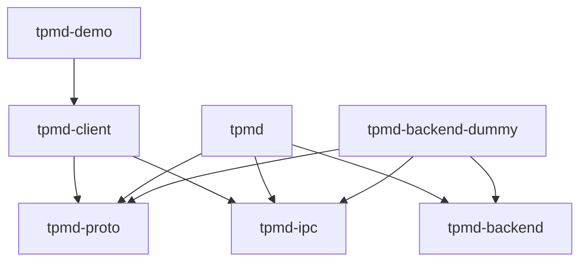
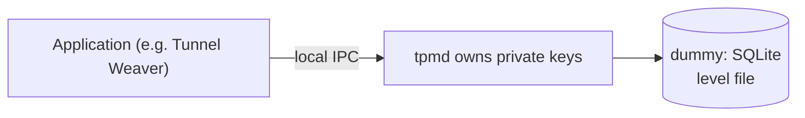

# tpmd — architecture and custody notes

> Companion to [`protocol.md`](protocol.md). WVR-140 built the first backend
> (dummy) and the whole consumer contract; later tickets add the hardware and
> OS-keyring backends behind the same interfaces.

## Workspace

`tpmd` is an independent Rust workspace. Tunnel Weaver is the first *consumer*,
not a dependency: nothing here links against Tunnel Weaver, and the toy proves
the life-cycle with a simulated relay.

| Crate | Responsibility | Notable dependencies |
| --- | --- | --- |
| `tpmd-proto` | Serializable messages, Postcard frame codec, limits, version negotiation | `serde`, `postcard` — no OS or storage deps |
| `tpmd-backend` | The `Backend` trait, `SecurityLevel`, `Principal`, `Owner`, error taxonomy, `select_level` | `tpmd-proto` |
| `tpmd-backend-dummy` | SQLite software P-256 store (level `file`) | `rusqlite`, `p256`, `tpmd-ipc` |
| `tpmd-ipc` | Local endpoints, native caller authentication, secure filesystem, framed I/O | `tokio`, `libc` / `windows-sys` |
| `tpmd` | Daemon: serve loop, caller auth, namespace + floor enforcement, backend selection, CLI | the above |
| `tpmd-client` | Consumer API hiding the transport | `tpmd-proto`, `tpmd-ipc` |
| `tpmd-demo` | Toy consumer that walks the Tunnel Weaver life-cycle | `tpmd-client`, `p256` |

Two crates are not in the ticket's original list but are structurally required:

* **`tpmd-backend`** holds the trait both the daemon and every backend depend
  on. A backend cannot depend on the daemon (that would be a dependency
  cycle), so the shared interface lives in its own crate — exactly the
  "internal non-backend crate" the architecture document anticipates.
* **`tpmd-ipc`** holds the platform layer (endpoints, caller credentials,
  secure files) that both the daemon and the client need, plus the safe
  filesystem helpers the dummy store uses.

### One crate per backend mechanism

Backends are selected at **build time** by a feature with target-gated
dependencies, so a Windows build never compiles the Linux TPM backend and vice
versa. The daemon depends on exactly one backend crate and drives it through
the object-safe `Backend` trait. Adding a backend is a dependency change, not a
rewrite.



## Trust model



* The daemon is the **only** holder of private material and exposes operations,
  never key export. There is no export operation anywhere in the protocol.
* A process running as the **same OS user** is inside that user's trust
  boundary. The daemon's guarantee is *cross-principal* and *cross-namespace*
  isolation, not defence against the user's own malware.
* **Caller identity is not client-supplied.** It is derived from kernel peer
  credentials (`SO_PEERCRED`/`LOCAL_PEERCRED` on Unix, the named-pipe client's
  token SID on Windows). A UID or SID in a request payload is never trusted.
* Keys are addressed by `(principal, namespace, key_id)`. A lookup under the
  wrong principal or namespace returns `unknown_key` — "not yours" and "does
  not exist" are indistinguishable, so key existence never leaks.
* There is **no enumeration**: a caller can only address a key it already
  knows the fingerprint of.

## Security levels and the floor

```
hardware > sealed > keyring > file
```

* `--min-key-security` defaults to `sealed`.
* The dummy backend achieves only **`file`**: software keys in a
  permission-protected file, neither encrypted nor hardware-backed. It reports
  `file` truthfully in `WELCOME`, `status` and every `KeyInfo` — never
  `keyring`, `sealed` or `hardware`.
* `select_level` (in `tpmd-backend`) is the one place the "never silently
  weaken policy" rule lives: it returns the strongest available level at or
  above the requested floor, or refuses with `incompatible_policy` naming the
  required and available levels unless the caller passed `allow_below_floor`.
* Restarting or reconnecting never rewrites a key's level, and a lost key is
  never replaced by a weaker one behind the caller's back.

## Platform details

| Concern | Linux | macOS | Windows |
| --- | --- | --- | --- |
| Per-user endpoint | `$XDG_RUNTIME_DIR/tpmd/tpmd.sock` | `$TMPDIR/tpmd/tpmd.sock` | `\\.\pipe\tpmd-<fnv1a-of-SID>` |
| System endpoint | `/run/tpmd.sock` | — | — |
| Caller identity | `SO_PEERCRED` uid | `LOCAL_PEERCRED` uid | client token SID |
| Store directory | `$XDG_DATA_HOME/tpmd` (or `~/.local/share/tpmd`) | `~/Library/Application Support/tpmd` | `%LOCALAPPDATA%\tpmd` |
| Store protection | dir `0700`, DB `0600` | same | protected owner-only DACL on dir and file |
| Pipe protection | — | — | protected owner-only DACL on the pipe |

The `tpmd-client` looks for the user-scoped endpoint first, then the system
endpoint, so an application does not care whether the daemon runs per-user or
as a shared service.

### Per-user vs shared daemon

On **Windows and macOS the daemon runs as the non-root user**, so the OS scopes
the store to that user. On **Linux** it may run per-user or as a shared system
service; in the shared case, rows carry the authenticated `principal` so one
store serves many users safely. The dummy implements both with the same code —
in per-user mode the principal is simply constant.

## Signing contract

ECDSA P-256 / SHA-256, matching `weaver_mux::auth`. Public key = 33-byte SEC1
compressed (also the fingerprint); signature = 64-byte raw `r ‖ s`. The daemon
hashes the message with SHA-256 exactly once and signs the digest; signing is
deterministic per RFC 6979. See [`protocol.md` §10](protocol.md#10-signing-contract-the-part-that-must-be-exact).

## Evidence for WVR-140

Proven on this Linux machine and asserted in the test suite:

* The documented happy path runs end to end (`tpmd-demo run`): it starts the
  real agent, is refused at the `sealed` floor, provisions at `file` with
  consent, enrols the public key, signs a Tunnel Weaver-style transcript,
  verifies it independently, restarts the agent and resumes the same identity,
  destroys and re-creates, and shows an unreachable agent.
* A signature produced by tpmd was verified with **Tunnel Weaver's own**
  `weaver_mux::auth::verify` (a throwaway interop test, since tpmd must not
  depend on Tunnel Weaver).
* Frame bounds, malformed/zero-length frames, version and handshake mismatches,
  namespace limits, disconnects, concurrency, restart persistence, namespace
  isolation and floor refusal each have tests.
* Cross-user isolation is exercised with a real second OS account
  (`tpmdtest`): the second user cannot reach the socket, and when the socket is
  reachable it still gets `unknown_key`.
* The dummy engine builds on all three target OSes; the Windows transport code
  is compiled for `x86_64-pc-windows-msvc` and the full suite runs on the
  Windows VM and the M1 Mac used to prove the platform backends.

## Out of scope for WVR-140

Keyring, Linux TPM, Windows CNG and macOS Secure Enclave backends
(WVR-141/142/143/144/151); packaging and installers (WVR-145…150); any real
relay (the demo's relay is simulated); `sign_prehash`; additional algorithms.
