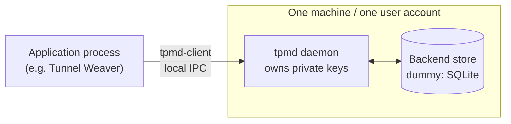
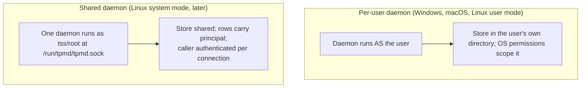
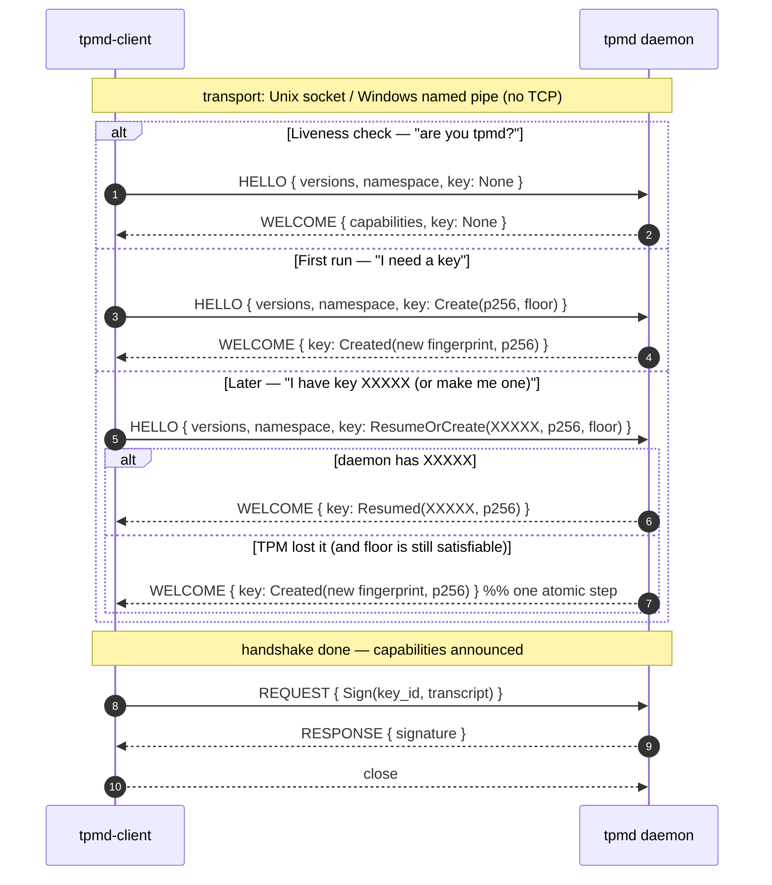
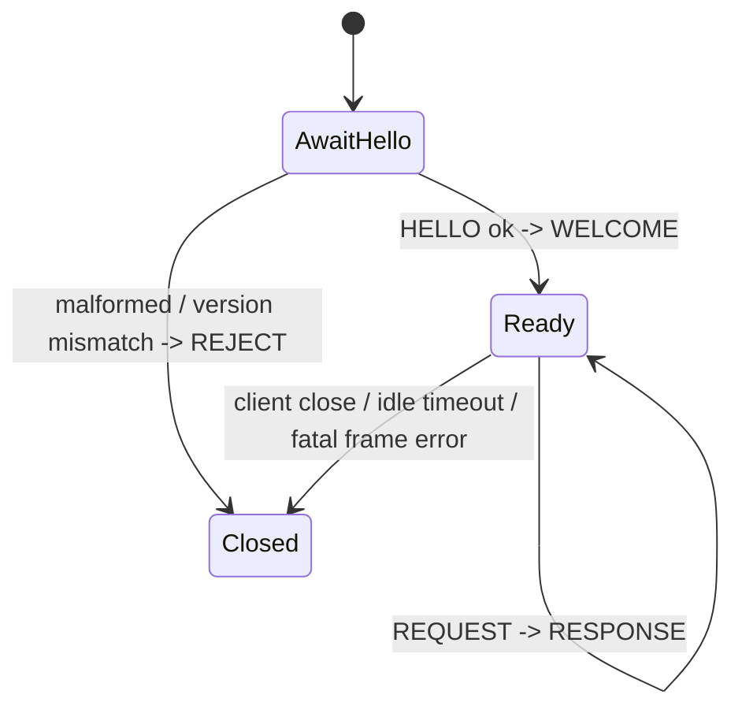
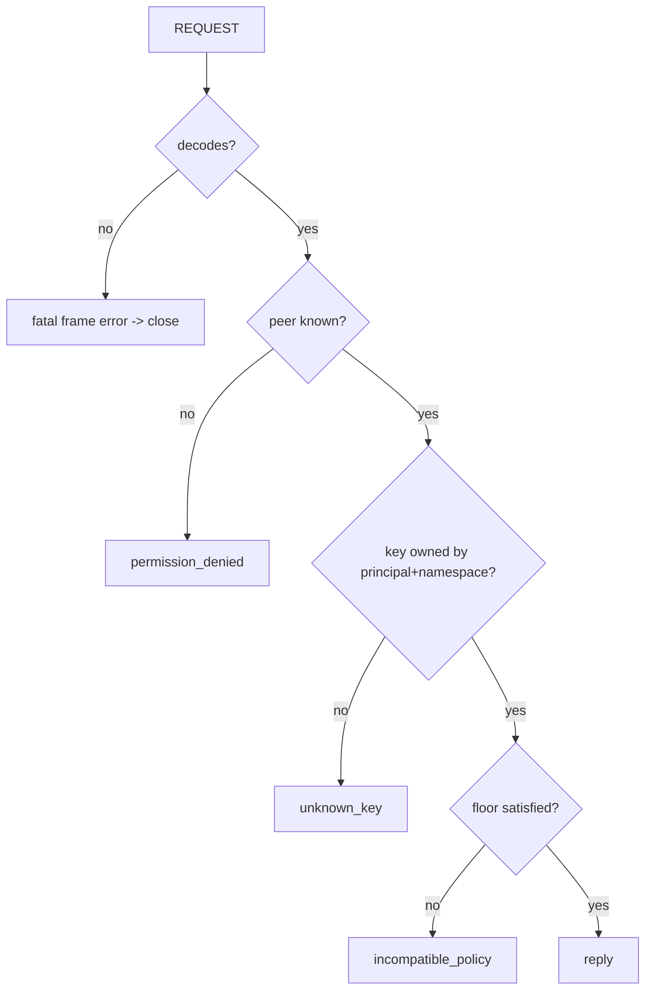
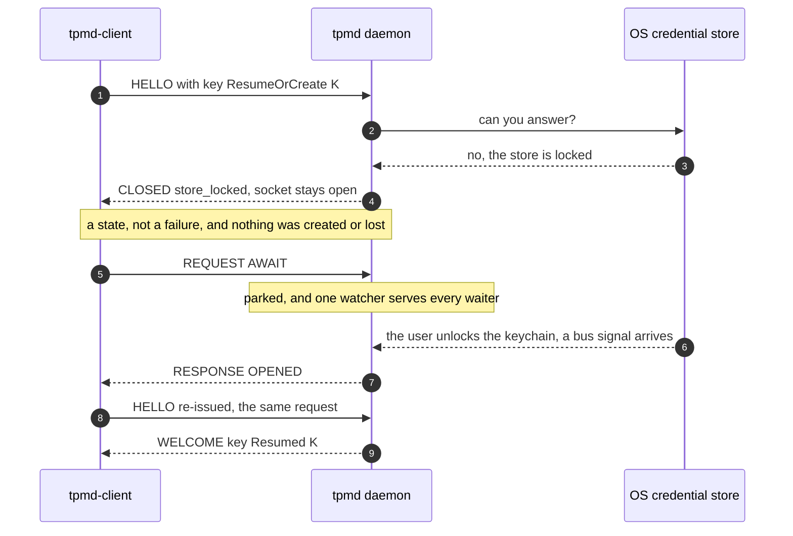
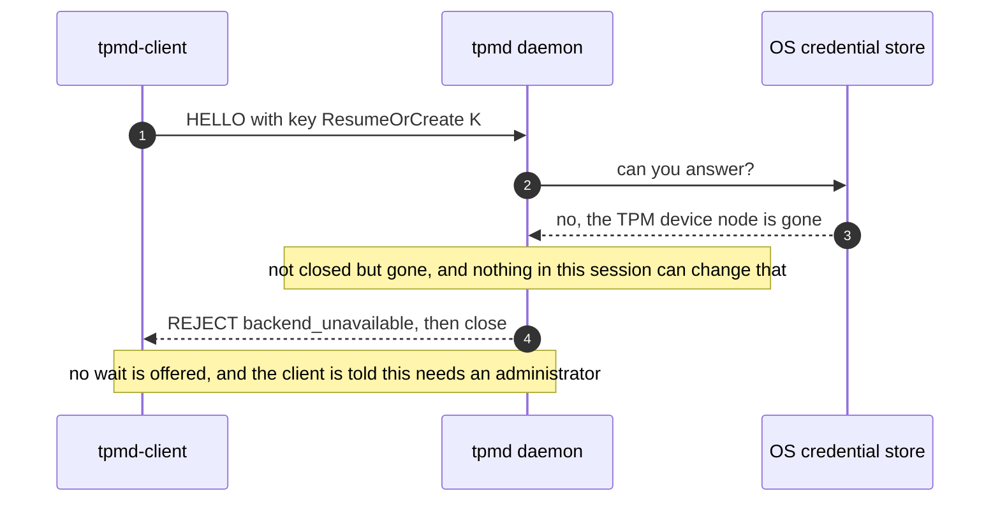
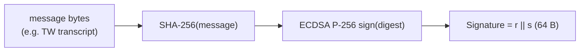

# tpmd — design and local wire protocol

> Status: **draft for review (rev 3)**. Key establishment is now an *atomic*
> resume-or-create in the handshake; a `None` handshake doubles as a liveness
> probe. Nothing here is implemented yet.

## 1. What tpmd is

`tpmd` is a local **key agent**: a daemon that owns private signing keys and
performs signing on behalf of local applications, so applications never hold
or export private key material.

Applications talk to the daemon over a **local** IPC channel through the
`tpmd-client` library. The first consumer is **Tunnel Weaver** (a P-256 device
key for its mux handshake), but Tunnel Weaver is not a dependency of tpmd —
the demo proves the whole life-cycle with a simulated relay.

WVR-140 builds the **dummy** engine: a software P-256 store in SQLite that
works on **Linux, Windows and macOS from day one**. It reports security level
`file` and is the weakest rung of the ladder; the real hardware/keyring
backends arrive later behind the same interface.

## 2. Goals of this slice (WVR-140)

- A workspace with a daemon, a client library, a shared protocol crate, a toy
  consumer, and one backend (SQLite/dummy).
- A complete, documented consumer contract settled *before* hardware work.
- Cross-platform local IPC with **native caller authentication**.
- Software P-256 keys, persisted, permission-protected, never exported.
- Status discovery, atomic key establish, sign, describe, destroy.
- A default security floor of `sealed` that the dummy **refuses** unless the
  caller explicitly opts down to `file`.
- A toy consumer that reproduces Tunnel Weaver's whole key life-cycle.
- Tests: framing, malformed/version input, disconnects/timeouts, concurrency,
  principal isolation, floor refusal, persistence, life-cycle errors.

## 3. Actors and trust model



- The daemon is the **only** holder of private material. It exposes
  *operations*, never key export.
- A local process running as the **same OS user** is inside that user's trust
  boundary. The daemon's job is to stop *other users* and *other application
  namespaces* from using keys they do not own — not to defend a user against
  their own malicious process.
- Caller identity comes from **kernel peer credentials**, never from a value
  the caller sends in the payload.

## 4. Key scoping

A stored key is owned by the tuple:

```
(principal, namespace, key_id)
```

| Field | Meaning | Source of truth |
| --- | --- | --- |
| `principal` | The OS user the daemon authenticated on the connection | kernel peer credentials (Unix UID / Windows SID) |
| `namespace` | The application namespace the connection declared | the client's `HELLO` (namespacing, **not** identity proof) |
| `key_id` | The key's fingerprint = its SEC1-compressed public key | derived from the key |

### 4.1 Per-user vs shared daemon



- On **Windows and macOS the daemon must run as the non-root user**, so the
  OS already scopes the store to that user.
- On **Linux** the daemon may run as a per-user process *or* as a system
  service. The dummy always **records `principal` on every key**, so both
  modes share one implementation; in per-user mode the principal is constant.
- A request for a key owned by another `principal` or `namespace` is rejected
  as an **unknown key** — "does not exist" and "not yours" are
  indistinguishable, so key existence never leaks.

## 5. Connection life-cycle — atomic key establish

The handshake is where the connection's key is established. This is
**atomic**: a single `ResumeOrCreate` either gives the caller a usable key or
fails cleanly. There is no half state where a client has been told its key is
missing and is waiting to create one.



Rules:

- The **first** message from the client MUST be `HELLO`; anything else is a
  protocol error and the daemon closes.
- The daemon answers `WELCOME` (proceed) or `REJECT` (then closes).
- Once the handshake is done, messages are correlated request/response pairs.
- Requests MAY be pipelined; the daemon MAY answer out of order. The client
  matches responses by `id`. The reference client is sequential.
- **Establish is atomic and honest.** `ResumeOrCreate` never leaves a half
  state. If it returns `Created` when the caller asked to resume, the caller
  has been given a *new* identity and MUST re-pair — the daemon states this
  explicitly, so it is never *silent*.
- **The floor still binds.** A resume-or-create on a machine that lost its
  hardware and can now only reach `file` returns `Created` **only if**
  `allow_below_floor` is set; otherwise it fails with
  `incompatible_policy`. Reconnect never downgrades a level without consent.



## 6. Wire format

**The shape is not stable until the first release.** `postcard` is positional, so
*appending* a struct field or an enum variant leaves every existing frame
byte-identical — which is how `CLOSED`, `AWAIT`, `OPENED` and the two `store`
fields arrived without moving `PROTOCOL_VERSION` off 1. Nothing has been
released, so there is no peer to be backward-compatible with; the version
negotiation in §7 exists for the day that changes, and the first *released* wire
change is when a bump becomes real.

### 6.1 Transport and endpoint discovery

| Platform | Single-user endpoint | Shared/system endpoint | Caller authentication |
| --- | --- | --- | --- |
| Linux | `$XDG_RUNTIME_DIR/tpmd/tpmd.sock` (dir `0700`) | `/run/tpmd/tpmd.sock` | `SO_PEERCRED` |
| macOS | `$TMPDIR/tpmd/tpmd.sock` (dir `0700`) | — | `LOCAL_PEERCRED` |
| Windows | `\\.\pipe\tpmd-<hash-of-SID>` | — | named-pipe client token SID |

The `tpmd-client` **looks for the user-scoped endpoint first, then the
system endpoint**. There is **no TCP listener**. The user-scoped endpoint lives
in a directory only the owning user may enter (dir `0700`, socket `0600`).

The **system** socket is deliberately reachable by any local user: `/run/tpmd/tpmd.sock`
is mode `0666`, and clients need no `tss` group membership (they never open the
TPM). Reachability is **not** authorization — every operation is scoped to the
caller's kernel-derived principal, so a foreign user connecting to the shared
socket is answered `unknown_key`, not given access. The deployment provision the
socket's directory (systemd `RuntimeDirectory=`, `tmpfiles.d`, or the installer);
the daemon binds the path and applies the mode, and fails loudly if the
directory is missing.

### 6.2 Frame

Every message on the stream is exactly one frame:

```
+--------------------------+------------------------------+
| Length : u32 big-endian  | Payload : Length bytes       |
+--------------------------+------------------------------+
                            Payload = Postcard(Message)
```

- `Length` is the number of payload bytes, **big-endian**.
- `MAX_FRAME_LEN = 65536` (64 KiB). A length of `0`, or greater than the cap,
  or a truncated frame, is a **fatal** frame error: the daemon closes without
  answering.
- [Postcard](https://docs.rs/postcard) serialises the payload. Its own
  integers are varints and little-endian; only the 4-byte length prefix is
  big-endian. Stated explicitly so nobody "fixes" the mismatch.
- Postcard is positional: **field order is the schema**. Appending a field or
  enum variant is backward compatible; reordering/removing/changing meaning
  bumps the protocol version.

### 6.3 Version negotiation

- `HELLO` carries `min_version` and `max_version` (`u16`).
- The daemon selects the highest version in the intersection of
  `[client.min, client.max]` and `[MIN_PROTOCOL_VERSION, PROTOCOL_VERSION]`.
- No intersection → `REJECT { unsupported_version }`, then close.
- `WELCOME.version` is the selected version; later messages use it.

### 6.4 Limits (announced in `WELCOME`)

| Limit | Default | Purpose |
| --- | --- | --- |
| `max_frame_len` | 65536 | per-frame payload bound |
| `max_message_len` | 1048576 | largest `sign` message accepted |
| `max_namespace_len` | 255 | bound on `HELLO.namespace` |
| `idle_timeout_ms` | 30000 | daemon closes an idle connection |

### 6.5 Golden frames

Three frames pin the encoding (enum tag first, then Postcard varints, under the
big-endian length prefix). They are asserted in `tpmd-proto`'s tests:

| Message | Bytes |
| --- | --- |
| `Hello { min=1, max=1, namespace:"tpmd", key:None }` | `00000009 00 01 01 04 74706d64 00` |
| `Request { id:1, op:Status }` | `00000003 03 01 00` |
| `Response { id:1, Ok(Destroyed) }` | `00000004 04 01 00 04` |

## 7. Handshake messages

### `HELLO` (client → daemon, first frame)

```
Hello {
  min_version : u16,
  max_version : u16,
  namespace   : String,     // application namespace, <= max_namespace_len
  key         : KeyRequest,
}

enum KeyRequest {
  None,                                          // liveness/capability probe ("are you tpmd?")
  Create(ProvisionRequest),                      // always mint a fresh key
  ResumeOrCreate { key_id : KeyId, provision : ProvisionRequest },
                                                 // atomic: resume key_id if present, else create
}

struct ProvisionRequest {
  algorithm        : Algorithm,       // EcdsaP256Sha256
  min_security     : SecurityLevel,   // caller's floor
  allow_below_floor: bool,            // explicit consent to go lower
}
```

### `WELCOME` (daemon → client)

```
Welcome {
  version      : u16,
  principal    : String,        // "uid:1000" / "sid:S-1-5-..."
  capabilities : Capabilities,
  limits       : Limits,
  key          : KeyOutcome,
}

enum KeyOutcome {
  None,                         // probe handshake: no key involved
  Created(KeyInfo),             // "here's a new fingerprint, type X" (requires re-pair)
  Resumed(KeyInfo),             // "I have your key"
}

struct KeyInfo {
  key_id         : KeyId,          // the fingerprint == SEC1-compressed public key
  algorithm      : Algorithm,
  security_level : SecurityLevel,
  created_unix   : i64,
}

Capabilities {
  daemon             : String,             // "tpmd 0.1.0"
  backend            : String,             // "dummy"
  algorithms         : Vec<Algorithm>,     // [EcdsaP256Sha256]
  levels             : Vec<SecurityLevel>, // achievable: [File]
  default_level      : SecurityLevel,      // achieved now: File
  key_id_encoding    : String,             // "sec1-compressed" (33 bytes)
  signature_encoding : String,             // "raw-r-s" (64 bytes)
  store              : StoreState,         // Open | Closed(Closed) — §9.1
}

enum Algorithm { EcdsaP256Sha256 }
enum SecurityLevel { File, Keyring, Sealed, Hardware }   // ordered weakest → strongest
```

`WELCOME` is the **announce**: before doing anything, the client learns which
algorithms, security levels and encodings the daemon supports, which backend
runs, which key was established, and who the daemon thinks it is talking to.

### `REJECT` (daemon → client, then close)

```
Reject { code : RejectCode, message : String, detail : Option<ErrorDetail> }
enum RejectCode {
  UnsupportedVersion,   // no protocol version in common
  BadHandshake,         // first frame was not HELLO
  NamespaceTooLong,
  ShuttingDown,
  IncompatiblePolicy,   // key establishment refused by the floor (carries ErrorDetail::Floor)
  KeyError,             // key establishment failed for another reason
}
```

A refused key establishment carries the same structured [`ErrorDetail`] as a
failed request, so a client can retry with `allow_below_floor` after seeing
exactly which level was required and which was available.

### `CLOSED` (daemon → client, **not fatal**)

```
Closed { code : ErrorCode, message : String, detail : Option<ErrorDetail> }
```

The one answer that says "not now" without saying goodbye. It is sent when the
store that holds the keys is **shut** — a locked keychain, a locked Secret
Service collection — which for a user-session store is *normal*, not a failure.

`REJECT` closes the connection and means something fatal (bad handshake, no
version in common, a dependency that is gone). `CLOSED` keeps it open, is never
`unknown_key`, `key_loss` or `permission_denied`, and is followed by one of:

* `AWAIT` (§8.7), and then `OPENED` when the store can serve;
* a fresh `HELLO`, which is how a client tries again once it has been told the
  store is open — establishment stays atomic, and the daemon never resumes a
  handshake by itself.

## 8. Operations (after handshake)

```
Message  = Hello | Welcome | Reject | Request | Response
Request  { id : u64, op : Op }
Response { id : u64, result : Result<Reply, Error> }
```

The client chooses `id`; the daemon echoes it. `id` values are opaque and need
only be unique per connection.

```
enum Op {
  Status,
  Provision(ProvisionRequest),    // mint an extra key (e.g. rotation) without reconnecting
  Describe { key_id : KeyId },    // metadata for a key you own
  Sign     { key_id : KeyId, message : Vec<u8> },
  Destroy  { key_id : KeyId },
}

enum Reply {
  Status(Status),
  KeyId(KeyId),                   // Provision
  KeyInfo(KeyInfo),               // Describe
  Signature(Signature),           // Sign
  Destroyed,                      // Destroy
}
```

### 8.1 `status`

```
Status {
  daemon        : String,
  backend       : String,
  principal     : String,
  namespace     : String,
  levels        : Vec<SecurityLevel>,
  default_level : SecurityLevel,
  default_min_security : SecurityLevel,   // daemon's configured default floor (sealed)
  store         : StoreState,             // Open | Closed(Closed) — §9.1
  selection     : BackendSelection,       // which backend this machine chose — §11
}
```

`backend` is a free-form string. It carries the backend's name, and for a
backend that talks to a named underlying store it also names that store — e.g.
`keyring (secret-service)` — so a user can tell *which* store is serving them.
This is a value change only: the type, the protocol version and the
`tpmd-client` library are unchanged, and the machine-readable
`WELCOME.capabilities.backend` keeps the bare backend name (`keyring`).

### 8.2 `provision` / `HELLO.key = Create`

`ProvisionRequest` mints a key and returns its **`KeyId` = its fingerprint** =
the 33-byte SEC1-compressed public key.

- The daemon enforces the floor: it selects the strongest level the backend
  can achieve that is `>= min_security`. The dummy only reaches `file`.
  - `min_security` unmet and `allow_below_floor = false` →
    `Error { incompatible_policy }` naming *required level*, *available
    level*, the *consequence*, and how to opt in.
  - `allow_below_floor = true` → the key is created at the achievable level
    (what the demo and tests do, at `file`).
- **No silent downgrade.** Reconnect/establish never rewrites a key's level.
- Each `provision` creates a **new** key; there is no "get or create"
  (`ResumeOrCreate` is the get-or-create, and it lives in the handshake).

### 8.3 `describe`

Returns `KeyInfo` for a key owned by the caller's `(principal, namespace)`,
so a caller can read the achieved security level and confirm ownership
without signing. A foreign or unknown fingerprint returns `unknown_key`.

### 8.4 `sign` — use a key without seeing it

```
Sign { key_id : KeyId, message : Vec<u8> } -> Signature

Signature([u8; 64])   // raw big-endian r || s
```

The caller passes the **fingerprint instead of the key**, exactly like calling
the crypto function but with a handle. The daemon SHA-256-hashes `message`
and ECDSA-signs the digest (see §10). `message` is bounded by
`max_message_len`.

> v1 supports **message input only** — the minimum Tunnel Weaver needs. A
> digest-input variant (`sign_prehash`) can be added later without a wire
> break.

### 8.5 `destroy`

`Destroy { key_id }` removes the key permanently, returning `Destroyed`.
Destroying an unknown/foreign key returns `unknown_key` (which a caller may
treat as already-destroyed).

### 8.6 Deliberately absent: enumeration

**Keys cannot be listed.** There is no `list` operation. A caller addresses a
key only by its fingerprint, which it must already know. This matches "if you
know you know" and stops a same-user process from discovering another app's
keys.

### 8.7 `await` — told when the store can serve, instead of guessing

```
Op::Await                    // no arguments, and deliberately no timing
Reply::Opened(Capabilities)   // the store is usable again
```

`AWAIT` asks the daemon to answer when its store can serve. It carries **no
timing parameter**, because noticing that a store reopened is the daemon's
business: it is the component that knows what its own dependency is, and a
`retry_after` would only invite a client to poll something better informed than
itself. One request, one answer.

* Store **open** → answered immediately with `OPENED` and fresh capabilities.
* Store **closed** → the daemon *parks* the request, waiting on its own
  detection (a session-bus signal on Linux, an interval elsewhere), and answers
  `OPENED` when the store comes back.
* Store **gone** while waiting → answered with `backend_unavailable`, and the
  connection closes. Nothing is left parked on a dependency that will not return.
* Store **gone** already → refused outright, with no wait offered at all.

`OPENED` is a **snapshot, not a promise**: the very next operation may still be
refused if the store shut again, and a client may `AWAIT` once more.

Other requests may be answered while an `AWAIT` is outstanding — responses are
matched by `id`, and the daemon answers out of order — so a waiting client can
still ask `STATUS`.

## 9. Errors



```
Error { code : ErrorCode, message : String, detail : Option<ErrorDetail> }

enum ErrorCode {
  UnsupportedVersion,   // could not negotiate (handshake only)
  MalformedFrame,       // reserved; normally a fatal close instead
  PermissionDenied,     // peer not permitted to talk to the daemon at all
  UnknownKey,           // fingerprint unknown, or not owned by caller+namespace
  IncompatiblePolicy,   // requested floor cannot be met
  BackendUnavailable,   // backend failed to initialise / disappeared
  StoreLocked,          // store present but locked (keyring-relevant later)
  KeyLoss,              // key material lost/invalidated (hardware-relevant later)
  InvalidRequest,       // semantically invalid request
  Internal,             // unexpected daemon failure
}

enum ErrorDetail {
  Floor { required : SecurityLevel, available : SecurityLevel },
}
```

These classes are reported **separately**, never collapsed: "daemon
unavailable" is a *transport* condition (connect/read fails), distinct from
`permission_denied`, `store_locked`, `unknown_key`, `incompatible_policy` and
`key_loss`. Key loss never auto-recovers with a weaker key behind the
caller's back; the caller learns via `Created` (or `incompatible_policy`) and
re-pairs.

### 9.1 A closed store is a state, not an error

The store that holds keys is user-session-scoped, so it is **shut a lot of the
time**: the screen is locked, the user is logged out, the keyring daemon has not
started yet. Two conditions hide behind "it will not answer", and they are told
apart by **who can change it**:

| | **closed** | **gone** |
| --- | --- | --- |
| Means | the dependency exists, but will not answer yet | the dependency is not there, or cannot be opened at all |
| Examples | login keychain locked, Secret Service collection locked | no TPM device node, no session bus at all, provider refuses to open |
| Who changes it | **the user** — unlock it, log in | nobody, for this daemon's lifetime |
| Answer | `CLOSED` (not fatal), and `AWAIT` is worth it | `REJECT backend_unavailable` (fatal), no wait offered |
| Client should | wait, or retry later | tell its user that tpmd needs an administrator |

The daemon decides which it is, because only the backend knows its own
dependency: it **probes existence** rather than reading error text (which
differs per platform and per provider, and has misled before). Waiting is only
ever offered for a *closed* store, so a client can never be parked on something
that will not return.



The other half of the same rule: a store that is *gone* is refused rather than
waited on, and the refusal says so.



Three invariants follow, and they are what keep "wait for the store" from
becoming "hang for ever":

1. Only a **closed** store is waitable; a gone one is refused, immediately.
2. Every wait ends: in `OPENED`, or in `backend_unavailable` if the store turned
   out to be gone while waiting.
3. The daemon never offers a wait it cannot honour — if the existence probe says
   the dependency is gone, there is no wait to enter.

What bounds patience is the **caller's** business, deliberately: the protocol
promises no window, the daemon holds a parked connection for as long as the
session lasts (the socket dies with it), and a client that will not block simply
closes the socket — which the daemon treats as giving up, holding nothing for it.

`STATUS` and `Capabilities` report the store, so a client can tell "is it
running?" from "can it sign right now?" without attempting an operation:

```
StoreState = Open | Closed(Closed)
```

## 10. Signing contract (the part that must be exact)

Algorithm: **ECDSA P-256 with SHA-256**, matching
`weaver_mux::auth::{transcript, verify}`.

| Encoded value | Bytes | Notes |
| --- | --- | --- |
| public key (`KeyId`) | 33 | SEC1 **compressed** (`0x02`/`0x03` + X) |
| signature | 64 | raw big-endian `r ‖ s`, each left-padded to 32 bytes |

Hash discipline — the daemon hashes the message once and never re-hashes:



- This reproduces exactly what Tunnel Weaver's client does today
  (`Signer::sign(transcript)`): digest = `SHA-256(transcript)`, and
  `weaver_mux::auth::verify(key, transcript, sig)` accepts the result.
- Determinism comes from RFC 6979 (the `p256` crate default); no RNG at sign
  time.

## 11. Security levels and the floor

```
Hardware > Sealed > Keyring > File
```

- `--min-key-security` defaults to **`sealed`**.
- The dummy backend achieves only **`file`**, so with the default floor
  provision/establish fails with `incompatible_policy` unless the caller
  passes `allow_below_floor = true`.
- The Linux TPM backend (`linux-tpm`) achieves **`sealed`** and **`hardware`**,
  so on a machine with a usable TPM the default `sealed` floor is met without
  consent. Selection prefers the strongest usable backend, so `hardware` is
  chosen whenever the TPM can create an ECC child.
- The keyring backend (`keyring`) achieves only **`keyring`**: the scalar lives in
  the operating system's credential store, but signing is still software.
  Selection prefers it over the dummy, so on a machine without a usable TPM the
  default `sealed` floor now fails against `keyring` rather than against `file` —
  unless the host's store cannot be reached, in which case the backend reports
  itself unusable and selection falls through to `dummy`.
- A store that is merely **closed** is still a *candidate*: a locked keychain is
  not a reason to fall to a plainer store, and doing so would be a silent custody
  change. The ladder therefore skips only a backend whose dependency is **gone**
  (§9.1), and reports it with the reason.
- **The choice is sticky.** It is made once, recorded, and never changed by the
  daemon: closing produces `closed`, a vanished dependency produces
  `backend_unavailable`, and both arrive from the *remembered* backend. `status`
  reports the choice in `selection`:

```
BackendSelection {
  backend            : String,          // the backend serving this connection
  chosen_unix        : Option<i64>,     // when it was committed; None while nothing has served
  reason             : Option<String>,  // why, in the daemon's words
  stronger_available : Option<String>,  // what the ladder would pick now — information, not an action
}
```

  `stronger_available` is the one part that is advisory: adopting it re-keys the
  device, so it is an administrator's decision (the CLI's `backend` verb) and
  never the daemon's. Changing the backend by hand — or forgetting the record —
  is therefore outside the protocol entirely: it is a local administrative act.
- The demo and tests opt in at `file`, proving both the refusal and the
  consented path.
- The daemon reports the *achieved* level truthfully in `WELCOME`, `status`,
  and `KeyInfo` — never `sealed`/`keyring`/`hardware` for the dummy, and never
  a level a key was not actually created at.

Store protection (one SQLite file shared by every backend):

| Platform | Protection |
| --- | --- |
| Unix | DB file `0600`, containing dir `0700`; the `-wal`/`-shm` sidecars live in that directory, so they are covered by the same rule |
| Windows | owner-only DACL on file and directory |

## 12. Does this accomplish Tunnel Weaver's goals?

Tunnel Weaver's client provides a `Signer` with `key_id()` (the public key)
and `sign(&transcript)`; the relay verifies with `weaver_mux::auth::verify`.
Mapping each need to the protocol:

| Tunnel Weaver need | Protocol mechanism | Covered? |
| --- | --- | --- |
| Provision a device key with a security floor | `HELLO.key = Create(floor)` or `provision` | ✅ |
| Learn whether the machine can meet the floor | `WELCOME.capabilities` + `status` | ✅ |
| Enrol the public key with the relay | `KeyInfo.key_id` / `describe` → 33-byte SEC1 | ✅ |
| Use the public key as the handshake `KeyId` | `KeyId` **is** the SEC1-compressed public key | ✅ |
| Sign the handshake transcript, verifiable by `weaver_mux::auth::verify` | `sign { key_id, message: transcript }` | ✅ |
| Reopen the same identity after an agent restart | `HELLO.key = ResumeOrCreate(fingerprint, …)` → `Resumed` | ✅ |
| Cope with a TPM that lost the key | same atomic call → `Created` (or `incompatible_policy`), then re-pair | ✅ |
| Report the achieved security level | `KeyInfo.security_level`, `status` | ✅ |
| Destroy / rotate / recreate | `destroy(key_id)` then `provision` | ✅ |
| Fail usefully: agent unreachable / floor rejected / key lost | transport error / `incompatible_policy` / `Created` vs `Resumed` | ✅ |
| Never export the private key | no export op anywhere | ✅ |

The demo cannot reuse `weaver_mux::auth::verify` (that would add a Tunnel
Weaver dependency), so its simulated relay verifies independently with the
`p256` crate directly — proving the encodings rather than trusting tpmd's own
code path.

## 13. Decisions taken

- **No enumeration** — fingerprint-only addressing.
- **Atomic establish in the handshake** — `None` (probe) / `Create` /
  `ResumeOrCreate`; the daemon is honest about `Created` vs `Resumed`.
- **Namespace in `HELLO`.**
- **Type name `KeyId`** = the fingerprint.
- **Message-only signing** (the minimum Tunnel Weaver needs).
- **Endpoint discovery**: user-scoped first, then `/run/tpmd/tpmd.sock` on Linux.
- **`describe` kept.**

## 14. Deliberately out of scope for WVR-140

- Backends other than dummy (keyring, TPM, CNG, Secure Enclave) — WVR-141/142/143/144/151.
- Packaging and installers — WVR-145…150.
- Any real relay; the demo's relay is simulated in-process.
- `sign_prehash`, extra algorithms, key attributes/policies beyond the floor.
